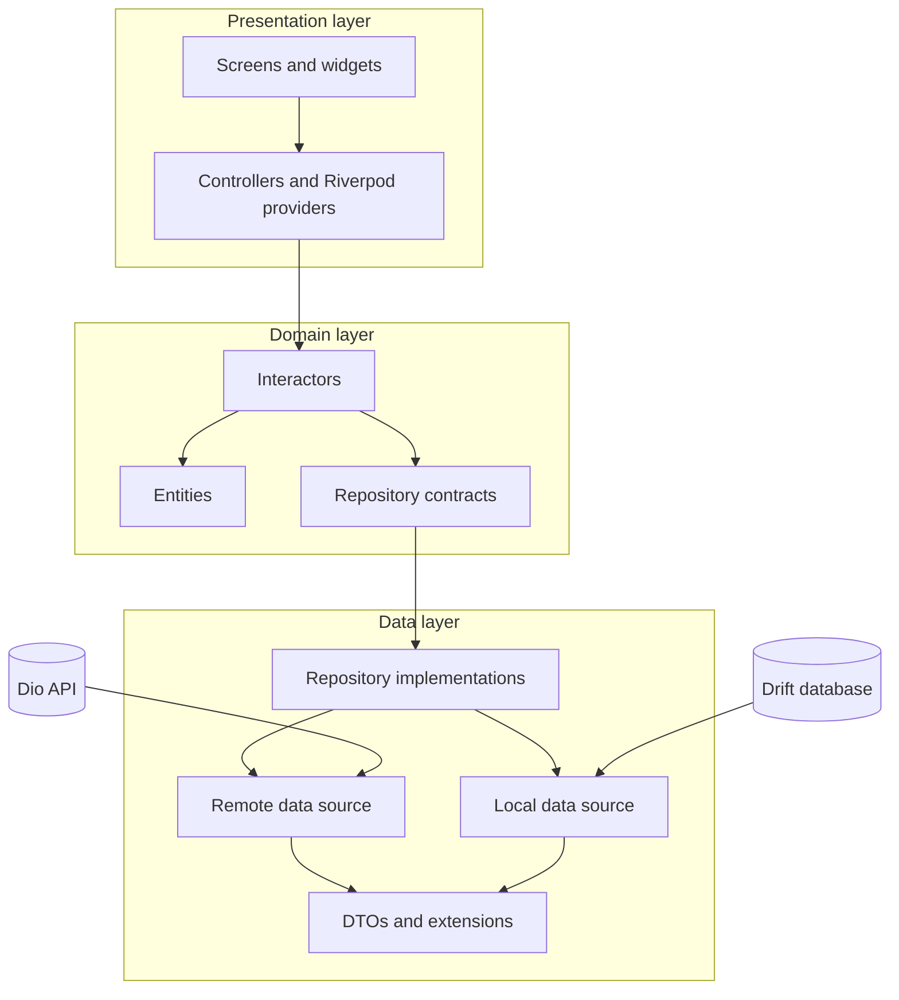

# Fvlox

Fvlox is a Flutter implementation of the Payment Approval Flow technical challenge. The scope is intentionally small: a production-minded payment approval feature with clear state handling, local persistence, network boundaries, testability, and a reviewer-friendly handoff.

## Project status

The app foundation and Payment Approval Flow are implemented. The checklist below records the verified scope and the remaining release-only checks.

- Flutter project: ready
- Dependency setup: ready
- Drift, Dio, Riverpod and GoRouter foundation: ready
- Patrol integration-test acceptance flow: implemented
- Payment feature UI and flow: implemented
- Native `integration_test` acceptance flow: verified on the configured iOS simulator and Android API 36 emulator

## Acceptance criteria

Tick each item when it is implemented and verified by an automated test or a documented manual check.

### Home

- [x] As a user, I can see a summary of my payment activity for the current month on the Home screen.
- [x] As a user, I can see my recent payments.
- [x] As a user, I can tap any payment to see its full details.
- [x] As a user, a payment I rejected does not count toward this summary - totals only reflect money that actually moved.
- [x] As a user, I can swipe a decided payment from right to left to delete it and see the refreshed state.
- [x] The backend bulk-delete contract is implemented and tested; the current mobile AC intentionally exposes single-row swipe deletion only.

### Payments list

- [x] As a user, I can see all my payments, most recent first.
- [x] As a user, each row shows enough for me to recognize the payment - who it is with, the amount, and its status (approved or rejected).
- [x] As a user, I can tap any payment to see its full details.
- [x] As a user, a payment I just approved or rejected appears at the top of the list right away.

### Payment details

- [x] As a user, I can only open details for a payment that has already been decided - never one still waiting on my approval.
- [x] As a user, I can tap back to return to wherever I opened it from.

### Debug FAB

- [x] As a user, I can see a floating action button no matter which screen I am on.
- [x] As a user, I can drag that button anywhere on screen, and it stays where I put it for the rest of my session.
- [x] As a user, tapping the button gives me a new incoming payment request to review.

### Approval

- [x] As a user, when a request comes in, I see a confirmation appear over whatever I was doing - I am not taken to a new screen for it.
- [x] As a user, I see the amount and the other party's name partially hidden, with only a reference number shown in full.
- [x] As a user, I can approve or reject the request.
- [x] As a user, approving takes me to the Payments list, where the payment now appears.
- [x] As a user, rejecting takes me back to wherever I was before the request appeared.
- [x] As a user, whether I approve or reject, I see the updated state everywhere that payment appears - the list, Home summary, and details.

### Technical definition of done

- [x] Empty state is displayed when there are no payments.
- [x] Loading, success, offline and error states are represented in the UI.
- [x] Dio failures are mapped to application failures; raw exceptions do not reach widgets.
- [x] Local storage is the read source when offline; offline mode is read-only.
- [x] Network and local data are reconciled through a repository, with one state source for the UI.
- [x] After every successful decide or delete, controllers re-read authoritative repository data for list/summary reconciliation. Delete also drops the row from local screen state immediately so `Dismissible` can leave the tree before the refresh completes.
- [x] Pending requests are transient overlay data and are never hydrated into the decided-payment cache.
- [x] Offline cached data has an explicit offline banner/read-only interaction state (widget + repository coverage; full offline path is also a manual device check).
- [x] Approve and reject require the demo OTP `8888`.
- [x] OTP feedback is displayed below the input field and success/error uses a toast.
- [x] Rejected payments remain visible in the list but are excluded from the Home total.
- [x] Amounts use one fixed currency: AED.
- [x] Important events use controlled Information, Warning and Error logs.
- [x] Text overflow, small screens, keyboard and safe-area layout are handled.
- [x] Unit tests cover domain rules and state transitions.
- [x] Widget tests cover the key UI states.
- [x] Integration acceptance tests cover request creation, approval/rejection, OTP and list/detail navigation.
- [x] README and decision notes describe deliberate shortcuts and follow-up work.

## Product decisions for this challenge

These choices keep the implementation small while leaving a clear path to production hardening.

- The Debug FAB asks the backend for a new request; the returned `pending` request exists only in the approval overlay until it is decided.
- Approval and rejection are performed from an overlay/dialog, not a separate screen.
- The demo OTP is hardcoded as `8888`; there is no retry counter or lockout in this challenge.
- The full amount and recipient are revealed only after successful OTP verification. The reference remains visible in full.
- Pending requests remain out of the decided Payments list and cannot open Payment Details.
- Rejected payments remain visible in the list but do not contribute to the Home total.
- Offline mode supports reading cached data only. Creating or deciding a payment requires the online path when the backend integration is enabled.
- The first version supports a single currency, AED.

Production follow-ups are recorded in `docs/decisions.md`: real OTP/biometric verification, retry limits, audit events, stronger persistence encryption, pagination, and observability integration.

## Technology baseline

### Toolchain

- Flutter `3.38.9`, stable channel
- Dart `3.10.8`
- Android SDK `36.0.0`
- Xcode `26.2`
- CocoaPods `1.16.2`
- Java OpenJDK `17` for the Android/Gradle build

### Runtime dependencies, grouped by purpose

#### Network

- `dio: 5.11.1` - HTTP client
- `connectivity_plus: 7.3.1` - connectivity awareness

#### State management and navigation

- `flutter_riverpod: 2.6.1` - state management and dependency injection
- `riverpod: 2.6.1` - provider primitives
- `go_router: 17.5.0` - navigation

#### UI and presentation

- `cupertino_icons: 1.0.8` - platform icons
- `intl: 0.20.2` - date and amount formatting
- `flutter_floaty: 0.2.0` - draggable FAB motion and interaction surface
- `pinput: 6.0.2` - animated, masked PIN/OTP input with autofill-ready behavior

#### Persistence and serialization

- `drift: 2.34.4` and `drift_flutter: 0.3.1` - local relational persistence
- `json_annotation: 4.12.0` - JSON model annotations

API request/response tracing is provided by the Dio `ApiTraceInterceptor` and is
enabled in debug mode through the existing `AppLogger`.

### Development and testing dependencies

- `build_runner: 2.15.1`
- `drift_dev: 2.34.0`
- `json_serializable: 6.14.1`
- `flutter_gen_runner: 5.15.0`
- `patrol: 4.10.0`
- `integration_test` from the Flutter SDK
- `flutter_launcher_icons: 0.14.4`
- `flutter_native_splash: 2.4.7`

Riverpod code generation is intentionally not enabled. Manual providers keep the dependency graph compatible with the current Flutter SDK and Drift generator while remaining easy to migrate later.

## Architecture

The project follows a feature-first Clean Architecture variant. The runtime call flow is:



Rules:

1. Widgets contain UI only; they do not call Dio, Drift or repositories directly.
2. Controllers/providers expose presentation state and call domain interactors.
3. Interactors contain business rules and depend on domain repository contracts.
4. Data sources know transport/storage details; repositories coordinate them.
5. Domain code does not import Flutter, Dio or Drift.
6. The repository is the single source of truth for the UI-facing payment state.

## Source layout

```text
lib/
├── main.dart
├── app/
│   ├── providers/          # composition root (Riverpod)
│   ├── router/
│   └── theme/
├── core/
│   ├── errors/
│   ├── network/
│   ├── local_database/
│   ├── connectivity/
│   ├── logging/
│   └── design_system/
├── l10n/                   # generated localizations
├── gen/                    # flutter_gen assets
└── features/
    └── payment_approval/
        ├── domain/
        │   ├── entities/
        │   ├── app_state/{home,payments,approval,feature,shared}/
        │   ├── interactors/{home,payments,approval,feature}/
        │   └── repositories/
        ├── data/
        │   ├── data_sources/
        │   ├── extensions/
        │   ├── models/
        │   └── repositories/
        └── presentation/
            ├── shell/
            ├── screens/
            ├── widgets/
            ├── providers/  # barrel re-exports
            └── view_models/{home,payments,approval,details,feature,refresh,shell}/
```

Supporting folders:

```text
assets/
├── icons/
└── l10n/

integration_test/
├── acceptance_criteria_test.dart   # business acceptance (not Patrol)
├── app_launch_test.dart            # Patrol smoke + acceptance entry
├── base/test_base.dart
├── robots/
│   ├── app_robot.dart
│   └── payment_acceptance_robot.dart
└── scenarios/
    ├── app_launch_scenario.dart
    └── payment_acceptance_scenario.dart

docs/
├── architecture.md
├── decisions.md
├── product-spec.md
├── sprint-plan.md
├── testing.md
└── asset-licenses.md
```

## Local setup

```bash
cd /Users/huy.nguyenquang/Documents/fvelox/fvelox
flutter doctor -v
flutter pub get
```

The app can be run on a connected device or simulator:

```bash
flutter devices
flutter run
flutter run -d <device-id>
```

## Code generation

Run after adding Drift tables/DAOs or JSON-annotated models:

```bash
dart run build_runner build --delete-conflicting-outputs
```

For active development:

```bash
dart run build_runner watch --delete-conflicting-outputs
```

Localization files belong in `assets/l10n/` and are generated through Flutter's `generate: true` configuration.

## Testing

### Static analysis and unit/widget tests

```bash
flutter analyze
flutter test
```

### Patrol E2E

Install the CLI once:

```bash
dart pub global activate patrol_cli
```

Run the Patrol acceptance flow with deterministic in-app demo data:

```bash
patrol test \
  --target integration_test/app_launch_test.dart \
  --dart-define=FVELOX_PATROL_TEST=true
```

Important distinction:

| Suite | Runner | Scope |
|-------|--------|--------|
| `integration_test/acceptance_criteria_test.dart` | `flutter test` (`IntegrationTestWidgetsFlutterBinding`) | Business acceptance flow (uses `DemoPaymentRepository`) |
| `integration_test/app_launch_test.dart` | `patrol test` | Device launch smoke + payment acceptance flow |

```bash
flutter test integration_test/acceptance_criteria_test.dart -d <device-id>
patrol test \
  --target integration_test/app_launch_test.dart \
  -d <device-id> \
  --dart-define=FVELOX_PATROL_TEST=true
```

The deterministic acceptance flow covers:

1. Launch app and verify empty Home state.
2. Drag the Debug FAB and create a pending request (demo repository).
3. Verify the approval overlay and masked recipient/amount.
4. Approve with OTP `8888`, then verify the payment appears and Home total changes.
5. Create another request, reject it, and verify it remains in the list but does not change the Home total.
6. Open decided payment details and verify back navigation.
7. Verify pending payment details cannot be opened.
8. Swipe a decided payment right-to-left, verify delete success, and verify the refreshed list and Home summary.

Offline read-only behavior is covered by widget tests, repository tests, and a **manual device check** (airplane mode). It is not part of the native acceptance suite above.

## Build and handoff

Debug APK:

```bash
flutter build apk --debug
```

Release APK:

```bash
flutter build apk --release
```

The Android Gradle project targets Java 17. If Flutter is configured to use a newer
Android Studio JDK, point it to a Java 17 installation before building:

```bash
flutter config --jdk-dir=<path-to-jdk-17>
```

The generated APK can be shared directly with reviewers. Source code can be shared through a sanitized public repository or a private repository invitation; no personal GitHub repository needs to be exposed.

Before handoff:

- [x] `flutter analyze` passes.
- [x] `flutter test` passes.
- [x] Native acceptance (`integration_test/acceptance_criteria_test.dart`) covers the business flow above.
- [ ] Patrol acceptance flow passes on the target device. The test bundle builds; Android currently fails installation with `INSTALL_FAILED_INSUFFICIENT_STORAGE`, while iOS fails before Dart execution because the simulator XCTest daemon cannot establish its device socket.
- [ ] Release APK installed and smoked on a clean device (splash, offline banner, approve/reject, FAB, no overflow).
- [x] Fresh arm64 release APK rebuild completes locally with `flutter build apk --release --target-platform android-arm64`.
- [x] Acceptance Criteria above are updated.
- [x] `docs/decisions.md` contains the short implementation note and follow-up items.
- [ ] Optional `evidence/` folder (test logs, screenshots, short demo video) prepared for the reviewer.
